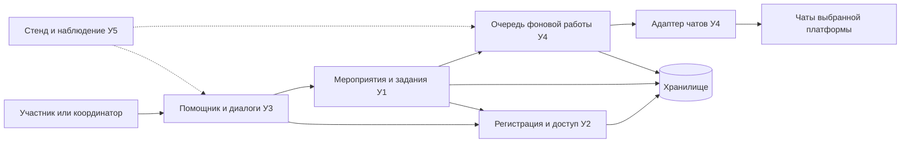

# План реализации для команды из пяти человек

Цель первого выпуска — провести полный цикл мероприятия: регистрация участника, проверка полномочий, предложение и согласование, рабочий чат, задания и напоминания, итоговый отчёт и архив. План распределяет обязанности между пятью участниками и задаёт последовательность реализации через зависимости и проверяемые результаты.

## Суть проекта и объём реализации

Основа — [требования R01–R13](REQUIREMENTS.md) из концептуального задания. В MVP входят все описанные в нём основные сценарии. Мессенджер, стек и инфраструктура в задании не определены: решения D01–D06 согласуются перед реализацией зависящих от них задач. Автономная регистрация и управление доступом обязательны; подключение внешнего ядра в первый выпуск не входит.

Территориальные координаторы помогают с организацией мероприятий, профильные советы — с программой и специалистами. Общая координация рассматривает предложения, назначает ответственных и получает итоги и важные проблемы. Команда реализует один пилотный контур и проверяет на нём полный цикл работы.

## Пять участников и ответственность

| Участник | Основная роль | Зона ответственности | Основной партнёр по ревью |
| --- | --- | --- | --- |
| У1 | Технический лидер и разработчик мероприятий | Требования, контракты, модель данных, предложения, согласование, единственный ответственный, интеграция | У2 для бизнес-правил, У5 для сквозных сценариев |
| У2 | Разработчик регистрации и доступа | Профиль, согласия, роли, территории, направления, проверки и отзыв доступа, граница внешнего ядра | У1; запреты дополнительно проверяет У5 |
| У3 | Разработчик помощника и пользовательских сценариев | Регистрация в диалоге, все пункты меню, формы мероприятий, задания и обращения | У1 для сценариев, У2 для доступа |
| У4 | Разработчик интеграции с чатами и фоновых процессов | Адаптер платформы, членство и приглашения, напоминания, доставка итогов, архив | У2 для членства, У5 для надёжности |
| У5 | Инженер качества и эксплуатации | Стенд, CI, тестовые данные, интеграционные проверки, приёмка, резервирование, пилот и выпуск | У1; проверку восстановления наблюдает У4 |

У5 организует проверку качества, но каждый разработчик проверяет свой модуль. У1 отвечает за целостность продукта; решения о правилах участия и допуске людей остаются у заказчика. Участники команды разработки и роли пользователей приложения — разные сущности.

## Последовательность реализации

| Этап | Работа и участники | Условие готовности |
| --- | --- | --- |
| 1. Требования и основа проекта | У1 согласует объём и контракты T01–T02; У2 уточняет правила регистрации и доступа; У3 готовит прототип T11; У4 проверяет платформу T16; У5 готовит окружение и сценарии приёмки T21–T22 | Согласованы решения D01–D06, проверены возможности платформы, описаны контракты и подготовлен тестовый контур |
| 2. Регистрация и доступ | У2 реализует профили, роли и области полномочий T06–T09; У3 подключает регистрацию и меню T12–T13; У4 готовит операции членства T17; У5 проверяет разрешения и запреты T23 | Анкета сохраняется, меню работает, полномочия подтверждаются отдельно, доступ к чужим данным и чатам закрыт |
| 3. Мероприятия и участие | У1 реализует предложение, согласование и участие T03–T04; У3 подключает формы T14; У4 связывает чаты и участников с мероприятием T17; У5 проверяет интеграцию T23 | Предложение рассматривается, назначен один ответственный, рабочий чат связан с мероприятием, участники допускаются по правилам |
| 4. Задания и контроль | У1 реализует задания T05; У3 подключает их назначение и статусы T14–T15; У4 реализует напоминания и эскалации T18; У5 проверяет сценарии и сбои T23–T24 | Ответственный распределяет задания, исполнитель меняет статусы и запрашивает помощь, уведомления доходят до нужных получателей |
| 5. Итоги и архив | У4 реализует отчёт и архив T19–T20; У3 подключает форму отчёта T15; У1 связывает завершение мероприятия с заданиями; У2 подтверждает автономность T10; У5 выполняет сквозную приёмку T24 | Полный цикл проходит без внешнего ядра, итоги переданы в координацию, рабочий чат архивирован |
| 6. Пилот и передача | У5 ведёт T25 и проверяет восстановление и откат; У1 координирует исправления и приёмку; У2 проверяет доступ; У3 помогает участникам; У4 контролирует доставку и архив | Пилот принят заказчиком, инструкции и результаты проверок переданы, владелец эксплуатации назначен |

Этапы задают зависимости, а не запрет на параллельную работу. Независимые задачи выполняются параллельно после готовности нужного контракта. До готовности серверной реализации У3 использует согласованные тестовые ответы, а У5 — тестовые двойники; такая проверка не заменяет интеграцию с реальным модулем.

## Задачи реализации

Владелец отвечает за реализацию, локальную проверку и документацию задачи. В графе зависимостей указаны блокирующие входы для завершения; независимую подготовку можно начинать заранее. Состояние задач У1 приведено ниже; остальные задачи остаются в Backlog. Таблица служит готовым списком для трекера; отдельные GitHub Issues этим файлом не создаются.

### У1 Техническое руководство и мероприятия

| Задача | Выполненная работа | Условия общей приёмки |
| --- | --- | --- |
| T01 | Границы MVP, владельцы открытых решений и демонстрационные сценарии зафиксированы в [контрактах У1](U1_CONTRACTS.md); Python и SQLite согласованы | Ответы заказчика по D03, D04 и D06; практическая проверка платформы У4 |
| T02 | Описаны состояния, ошибки, версии, идемпотентность и точки интеграции; добавлена схема SQLite и серверные проверки | Совместное ревью контрактов с У2–У5 |
| T03 | Реализованы предложения, просмотр, очередь, утверждение и отказ; проверены повторы, перезапуск и конкурентные решения | Подключение реального провайдера У2 и интерфейса У3 |
| T04 | Реализованы заявки, приглашения, приём, удаление, подбор помощников и атомарная передача ответственности | Подключение справочника У2, интерфейса У3 и членства в чатах У4 |
| T05 | Реализованы задания, статусы, помощь, эскалации и завершение; проверены открытые задания, отчёт и подтверждение архива | Подключение У3–У4 и сквозная приёмка У5; независимое ревью перед merge |

Модуль У1 и его проверки готовы к командному ревью. Реальные внешние интеграции не объявляются выполненными на основании демонстрационных провайдеров.

| ID | Задача и критерии приёмки | Зависимости | Требования |
| --- | --- | --- | --- |
| T01 | Согласовать границы MVP, роли, решения D01–D06 и демонстрационные сценарии. У каждого открытого вопроса есть владелец и условие принятия решения | Нет | Все |
| T02 | Описать сущности, состояния и контракты модулей. Зафиксированы идентификаторы, ошибки, проверки доступа, повторные запросы и правило единственного ответственного | Первичный объём T01 | R04, R07, R13 |
| T03 | Предложение, просмотр своего предложения, очередь рассмотрения, утверждение или мотивированный отказ. Повторное решение не создаёт второй объект; утверждение без ответственного невозможно | T02, T07 для прав | R06, R07 |
| T04 | Участие, назначение и передача ответственности, подбор помощников по территории и интересам. Одновременные изменения не оставляют двух главных ответственных или ноль у активного мероприятия | T03, T08 | R07, R08 |
| T05 | Задания с исполнителем и сроком, статусы, запрос помощи, переход к завершению. Закрытие мероприятия согласовано с отчётом и архивом; открытые задания требуют явного решения ответственного | T04, T07 | R09, R11, R12 |

### У2 Регистрация и доступ

| ID | Задача и критерии приёмки | Зависимости | Требования |
| --- | --- | --- | --- |
| T06 | Профиль, справочники территории и направлений, согласия с версией и временем. Повторная регистрация не создаёт дубль; данные неполной анкеты не дают рабочий доступ | T02, D03 | R01, R02 |
| T07 | Серверная авторизация, подтверждение и отзыв ролей, журнал изменений. Самоназначение, подмена идентификатора и действие после отзыва отклоняются | T06, D04 | R04 |
| T08 | Области полномочий территории, совета и мероприятия; выдача только разрешённых сведений. Совмещение ролей работает без доступа к посторонним областям | T07 | R04, R05, R08 |
| T09 | Сценарий несовершеннолетнего по D03: ожидание, проверка, отказ и отзыв согласия. До подтверждения нет недопустимого доступа; выбранный порядок хранения и удаления данных описан и проверен | T06, T07, D03 | R01, R02, R04 |
| T10 | Автономность регистрации и граница интеграции: стабильный внутренний ID, будущая привязка внешнего ID и контракт обмена. Система стартует и выполняет регистрацию и доступ без внешнего ядра | T07, T08 | R13 |

### У3 Пользовательский помощник

| ID | Задача и критерии приёмки | Зависимости | Требования |
| --- | --- | --- | --- |
| T11 | Прототип регистрации и шести пунктов меню. Описаны отмена, возврат, исправление ввода, пустые состояния и отсутствие прав; сценарии просмотрены командой | Первичный объём T01 | R01–R03 |
| T12 | Диалог регистрации на выбранной платформе: все поля, согласия, продолжение после прерывания. Повторное «Начать» не дублирует пользователя | T11, T06, T16 | R01, R02 |
| T13 | Все шесть пунктов личного меню, списки своих мероприятий и заданий, разрешённые чаты, обращение к координатору с подтверждением приёма. Нет утечки сведений через кнопки | T12, T07, T08 для областей | R03, R04, R05 |
| T14 | Формы предложения, решения координатора, заявки на участие, приглашения и назначение заданий. Повторная кнопка безопасна; отказ и ожидание объяснены пользователю | T03, T04, T13, T17; контракт T05 | R06–R09 |
| T15 | Карточка задания, три статуса, запрос помощи и форма краткого отчёта с необязательными фото. Авторизованный пользователь получает подтверждение сохранения; ошибки не теряют введённые данные | T05 для заданий, T19 для полной интеграции отчёта | R09, R11, R12 |

### У4 Чаты и фоновые процессы

| ID | Задача и критерии приёмки | Зависимости | Требования |
| --- | --- | --- | --- |
| T16 | Техническая проверка D01 и адаптер мессенджера. Получение команд, отправка сообщений и привязка существующего чата проверены; возможности создания и архива подтверждены или заменены описанной ручной процедурой | Доступ к тестовой платформе, T02 для контракта | R03, R05 |
| T17 | Реестр четырёх типов чатов, приглашения, проверка членства, отзыв и повторная сверка. Нет приглашения без разрешения; частичный сбой не помечается успехом и доступен повтор операции | T16, T07, T08, T04 для мероприятий | R04, R05, R08 |
| T18 | Планировщик напоминаний и просрочек, часовые пояса, повторы доставки и правила важных проблем. После рестарта задание не теряется; дубли не меняют бизнес-состояние; завершённое задание не получает новое напоминание | T05 для интеграции, T16, D05 | R09, R10, R12 |
| T19 | Сохранение краткого отчёта и необязательных фото, доставка итогов в координацию. При недоступности платформы результат сохранён, доставка повторяется и её состояние видно ответственному | T04, T05, T16, D03 | R11, R12 |
| T20 | Архив мероприятия: доступ к материалам сохраняется по ролям, активная работа прекращается, напоминания отключены. Ручное архивирование при ограничении API требует подтверждения оператора | T17, T18, T19 | R05, R11 |

### У5 Качество и эксплуатация

| ID | Задача и критерии приёмки | Зависимости | Требования |
| --- | --- | --- | --- |
| T21 | Каркас тестового окружения, CI, конфигурация без секретов в Git. После D02 чистая установка запускается по README; CI проверяет сборку и доступные проверки; стенд отделён от будущей эксплуатации | D02, T02 для структуры | R13 |
| T22 | Матрица приёмки R01–R13, синтетические данные и сценарии отказа. Для каждого требования есть шаги, ожидаемый результат и владелец исправления | T01, T02 | Все |
| T23 | Интеграционные проверки профилей, областей, мероприятий, членства и задач. Проверены чужие ID, просроченные кнопки, двойные запросы, отзыв роли и согласия | T06–T09, T03–T05, T17 по готовности | R01–R09 |
| T24 | Сквозная приёмка, фоновые процессы, отчёт, архив и автономность. Проверены рестарт, недоступность платформы, возврат доставки и отсутствие повседневного спама в координации | T10, T12–T20, T23 | Все |
| T25 | Подготовка и проведение пилота, мониторинг, резервная копия и пробное восстановление, инструкция отката и сопровождения. Заказчик принимает итог, владелец эксплуатации назначен | T21, T24, D06 | Все |

## Архитектурные границы и точки интеграции

Предлагается модульное приложение с адаптером мессенджера. Выбор конкретных библиотек и версий выполняется в D02 после проверки D01.

Основные сущности: участник, согласие, территория, направление, назначение роли с областью, предложение/мероприятие, участие, чат и членство, задание, отчёт, вложение, уведомление и запись аудита. Участник имеет внутренний идентификатор, независимый от мессенджера и будущего ядра.

В T02 команда фиксирует следующие контракты:

- Регистрация возвращает состояние профиля и допуска; авторизация учитывает действие, объект и область полномочий.
- Мероприятие хранит состояние и одного главного ответственного после утверждения; замена ответственного атомарна и записывается в журнал.
- Каждая команда проверяет полномочия на сервере. Скрытая кнопка не является проверкой доступа.
- Команда на чат или уведомление имеет ключ операции и состояние исполнения. Повтор запроса не создаёт второе мероприятие, задание или членство.
- Адаптер возвращает подтверждённый результат либо ошибку/ожидание. Если платформа не обеспечивает идемпотентную отправку, возможный повтор сообщения учитывается отдельно от однократного изменения бизнес-состояния.
- Даты мероприятия и сроки заданий хранятся однозначно; отображение и напоминания используют согласованный часовой пояс.
- Отчёт сохраняется до отправки в координацию. Ошибка отправки не теряет отчёт и не означает успешную доставку.

Предлагаемый жизненный цикл мероприятия: предложение → рассмотрение → утверждено → подготовка → проведение → завершено → архив. Отказ и отмена — отдельные исходы с причиной. У1 согласует допустимые переходы в T02. Начальное состояние задания — «Назначено»; исполнитель использует три состояния из задания. «Нужна помощь» сохраняет исполнителя и создаёт обращение, а не завершает задачу.

Основная цепочка зависимостей: D01 и T02 → регистрация и права T06–T08 → мероприятие и участие T03–T04 → задания T05 и доступ к чату T17 → отчёт T19 → архив T20 → приёмка T24 → пилот T25. Напоминания T18 и интерфейс T12–T15 должны быть интегрированы до приёмки. Завершение независимых задач не заменяет проверку этой цепочки целиком.

## Приёмка MVP

| Сценарий | Обязательный результат | Проверяет |
| --- | --- | --- |
| Регистрация взрослого и незавершённая анкета | Полная анкета и согласия сохраняются; прерывание можно продолжить; неполная регистрация не даёт доступ | У5 с У2 и У3 |
| Несовершеннолетний | Утверждённый порядок согласия выполнен; ожидание, отказ и отзыв не открывают запрещённые возможности | У5 с У2 |
| Полномочия | Самоназначение и обращение к чужим данным запрещены; подтверждение и отзыв роли меняют доступ и фиксируются | У5 с У2 |
| Шесть пунктов меню | Каждый пункт выполняет заявленный сценарий, включая вступление, доступные чаты и обращение к координатору | У5 с У3 |
| Мероприятие | Участник предлагает, координатор рассматривает и назначает одного ответственного; отказ и отмена имеют понятное состояние | У5 с У1 |
| Чаты и участие | Все четыре типа представлены; человек может иметь несколько разрешённых членств; посторонний не входит и не получает сведения | У5 с У4 |
| Подготовка и помощь | Ответственный назначает задания; территория помогает с организацией, профильный совет — по необходимости с содержанием | У5 с У1 |
| Исполнение | Исполнитель меняет три предусмотренных статуса; помощь маршрутизируется ответственному; чужие изменения отклоняются | У5 с У1 и У3 |
| Напоминания и сбои | Просрочка обнаруживается, рестарт не теряет уведомления, сбой платформы виден и повторяется управляемо | У5 с У4 |
| Итоги и архив | Краткий отчёт сохраняется с фото или без, итоги доходят в координацию, чат архивируется, новые напоминания прекращаются | У5 с У4 |
| Автономность | При отсутствии внешнего ядра проходят регистрация, доступ и полный цикл мероприятия | У5 с У2 |
| Эксплуатация | Проверены резервная копия, восстановление и откат; секреты отсутствуют в репозитории и прикладных логах | У5 и У4 |

К выпуску нет открытых дефектов, позволяющих получить чужие данные, потерять задания/отчёты или заблокировать основной цикл мероприятия. Некритичные дефекты перечислены с владельцами и согласованным порядком устранения. Все требования R01–R13 имеют результат проверки, а заказчик подтверждает пилот. Показатель нагрузки и численность пилота согласуются в D06: произвольная производительность заранее не обещается.

## Риски и действия команды

| Риск | Последствие | Действие и владелец |
| --- | --- | --- |
| Платформа не поддерживает создание или архивирование чатов | Нельзя выполнить автоматический шаг | У4 проверяет в D01; ручная операция с подтверждением включается в интерфейс и инструкцию, либо меняется платформа |
| Нельзя надёжно отзывать доступ к чату | Нарушается принцип ограниченного доступа | У2 и У4 проверяют отзыв на реальном тестовом чате; неподходящую платформу не принимают в D01 |
| Не согласованы правила несовершеннолетних и обработки данных | Регистрация этой группы не может быть принята | У2 получает решение D03; блокер поднимается заказчику, сценарий не объявляется готовым |
| Разные представления участников о контрактах | Несовместимые модули и повторная работа | У1 фиксирует T02, изменения обсуждаются с потребителями; готовность этапа подтверждается сквозной демонстрацией |
| Дубли и временная недоступность платформы | Повторные действия или потеря доставки | У4 сохраняет состояние операций, вводит повтор и журнал ошибок; У5 проверяет сбои и восстановление |
| Неясное распределение ответственности или перегрузка У1 | Блокировка зависимых задач | У1 согласует владельцев задач и участников ревью; передача задачи сопровождается передачей контракта и текущего результата |
| Не определены участники и условия пилота | Нельзя подтвердить результат на реальном мероприятии | У5 согласует контур и условия в D06; стендовая репетиция не подменяет приёмку пилота |

## Передача в эксплуатацию

Команда передаёт исходный код, воспроизводимый запуск, конфигурационный шаблон без секретов, схему данных и миграции, результаты приёмки, инструкции координатора и администратора, порядок резервирования, восстановления и отката. У5 назначает совместно с заказчиком владельца эксплуатации и канал обращения; У1 фиксирует известные ограничения и оставшийся backlog.

Имена, аккаунты GitHub участников и приглашения в репозиторий в этот план не подставлены: распределение пока выполнено по пяти ролям. Приглашения и реальные назначения оформляются после определения состава команды.
